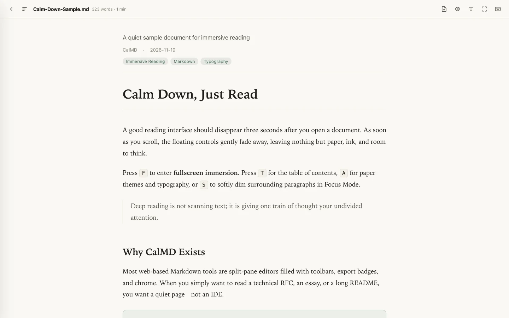

<p align="center">
  
</p>

<h1 align="center">CalMD</h1>

<p align="center">A calm, browser-based Markdown reader built for full-screen reading</p>

<p align="center">
  <a href="CHANGELOG.md"></a>
  <a href="LICENSE"></a>
</p>

<p align="center">
  <a href="https://tenonai.cn/">Website</a> · <a href="#documentation">Docs</a> · <a href="README.zh-CN.md">简体中文</a>
</p>

<picture>
  <source media="(prefers-color-scheme: dark)" srcset="docs/assets/reader-en-dark.webp">
  
</picture>

CalMD opens a local `.md` file, or a whole folder, in the browser and shows it as a quiet page for reading. There is no editor toolbar and no backend, and no file leaves your computer. It is for reading long documents such as READMEs, RFCs and essays.

## Quick start

Requires Node.js 20 or later.

```bash
npm install
npm run dev        # start the local dev server
npm run build      # build static files into dist/
npm test           # run the tests
```

## Features

- **Full-screen reading**: press `F` to go full screen; the header fades out as you scroll down.
- **Local files and folders**: drag in or pick a `.md` file, paste with `Cmd/Ctrl + V` or `V`, or open a folder so relative images and links between documents work. In Chromium-based browsers a saved file reloads in place and keeps your scroll position (`R` reloads by hand).
- **Paper themes and layout**: four color themes (`1`–`4`, `D` switches day and night), serif, sans-serif or monospace text (`Y`), five column widths (`W`) and three line spacings (`L`).
- **Single-key controls**: `J`/`K` scroll, `N`/`P` jump between sections, `G`/`Shift+G` go to the start or end, `,`/`.` switch documents in a folder; `?` lists every shortcut.
- **Focus mode**: `S` dims the paragraphs around the one you are reading.
- **Contents on demand**: a thin progress line at the top, the outline on `T` and the folder's documents on `B`.
- **Faithful CommonMark and GFM**: tables, task lists, GitHub alerts, front matter, code copy buttons, KaTeX math, Mermaid diagrams on demand and image zoom, without changing what the source says.

## Documentation

- [Changelog](CHANGELOG.md)
- [Project conventions](AGENTS.md), in Chinese

## Where your data goes

CalMD has no accounts and no server. Documents are parsed and sanitized with DOMPurify in your browser; preferences and the recent-documents list are kept in this browser's storage (localStorage and IndexedDB). Nothing is uploaded.

## Contributing

Bug reports, ideas and pull requests are welcome. Read [CONTRIBUTING.md](CONTRIBUTING.md) first. Everyone taking part follows the [Code of Conduct](CODE_OF_CONDUCT.md).

## Security

Please report security problems privately, as described in [SECURITY.md](SECURITY.md), and not in a public issue.

## License

[MIT](LICENSE). Copyright (c) 2026 Tenon Artificial Intelligence Technology Co., Ltd. (长沙榫卯人工智能科技有限公司)

---

<p align="center">
  Publisher&emsp;<a href="https://tenonai.cn/"> <b>Tenon AI</b></a>
</p>
