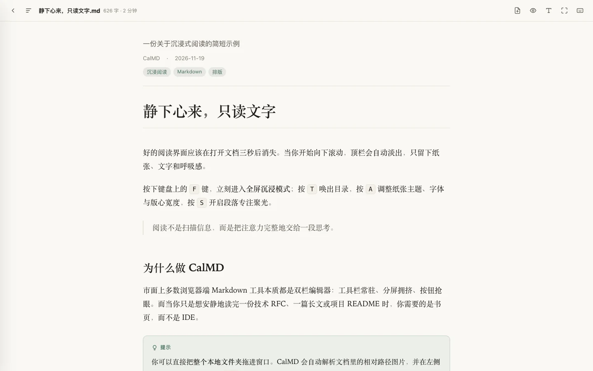

<p align="center">
  
</p>

<h1 align="center">CalMD</h1>

<p align="center">纯粹、安静的浏览器端 Markdown 阅读器，一切特性服务于全屏沉浸式阅读</p>

<p align="center">
  <a href="CHANGELOG.md"></a>
  <a href="LICENSE"></a>
</p>

<p align="center">
  <a href="https://tenonai.cn/zh/">官网</a> · <a href="#文档">文档</a> · <a href="README.md">English</a>
</p>

<picture>
  <source media="(prefers-color-scheme: dark)" srcset="docs/assets/reader-zh-dark.webp">
  
</picture>

CalMD 在浏览器里直接打开本地 `.md` 文件或整个文件夹，显示成一张安静的阅读页。没有编辑工具栏，没有后端，文件不离开你的电脑。适合读 README、RFC、长文这类长文档。

## 快速开始

需要 Node.js 20 及以上版本。

```bash
npm install
npm run dev        # 启动本地开发服务器
npm run build      # 构建纯静态文件到 dist/
npm test           # 运行测试
```

## 功能

- **全屏阅读**：按 `F` 进入全屏，向下滚动时顶栏自动淡出。
- **本地文件与文件夹**：拖入或选择 `.md` 文件，用 `Cmd/Ctrl + V` 或 `V` 粘贴，也可以打开整个文件夹，相对路径的图片和文档互链都能用。Chromium 系浏览器里，磁盘上的文件保存后原地刷新并保持滚动位置（按 `R` 手动刷新）。
- **纸张主题与版式**：素纸、暖笺、微墨、静夜四套配色（`1`–`4`，`D` 切换日夜），衬线、无衬线或等宽字体（`Y`），5 档版心宽度（`W`）和 3 档行距（`L`）。
- **单键操作**：`J`/`K` 滚动，`N`/`P` 跳章节，`G`/`Shift+G` 到开头或结尾，`,`/`.` 切换文件夹里的文档；按 `?` 查看全部快捷键。
- **段落聚焦**：按 `S` 柔化当前段落上下的内容。
- **按需唤出的目录与进度**：顶部一条细的阅读进度线，按 `T` 唤出目录，按 `B` 唤出文件夹文档栏。
- **忠实的 CommonMark 与 GFM**：表格、任务清单、GitHub 提示框、Frontmatter、代码复制按钮、KaTeX 公式、按需渲染的 Mermaid 图表和图片放大，不改动原文的内容。

## 文档

- [更新记录](CHANGELOG.md)
- [项目约定](AGENTS.md)

## 数据去向

CalMD 没有账号，也没有服务器。文档在你的浏览器里解析，并用 DOMPurify 净化；偏好和最近阅读记录存在这个浏览器的本地存储里（localStorage 和 IndexedDB）。不上传任何内容。

## 参与贡献

欢迎报告缺陷、提建议和提交 PR，请先读 [CONTRIBUTING.md](CONTRIBUTING.md)。参与的人都遵守[行为准则](CODE_OF_CONDUCT.md)。

## 安全

安全问题请按 [SECURITY.md](SECURITY.md) 私下报告，不要开公开的 issue。

## 许可证

[MIT](LICENSE)。Copyright (c) 2026 Tenon Artificial Intelligence Technology Co., Ltd. (长沙榫卯人工智能科技有限公司)

---

<p align="center">
  出品方&emsp;<a href="https://tenonai.cn/zh/"> <b>榫卯 Tenon AI</b></a>
</p>
